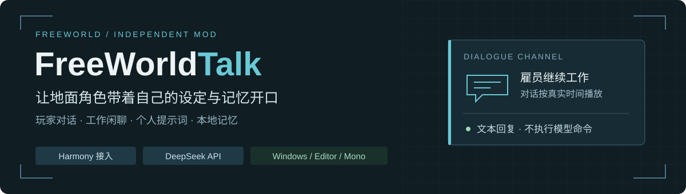
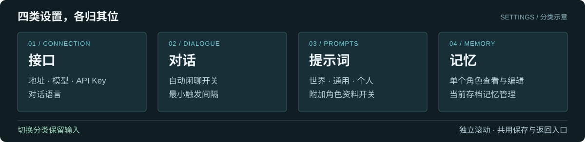
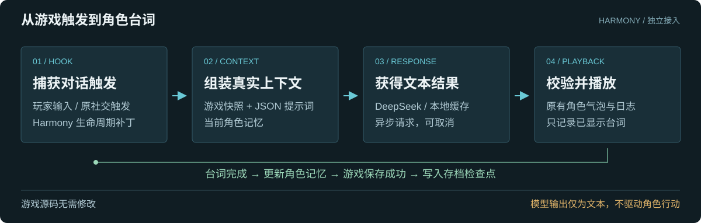
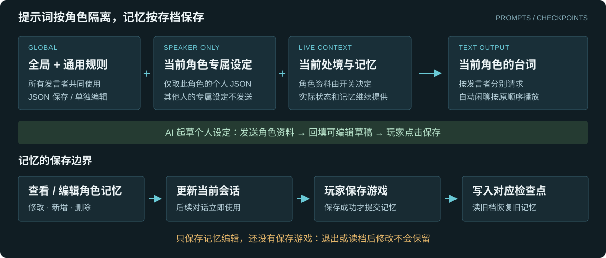

# FreeWorldTalk



**一个独立的 FreeWorld Harmony Mod。** 使用 DeepSeek 为玩家对话和地面角色闲聊生成台词，角色可以边工作边交流，并保留可编辑的个人提示词与本地记忆。

源码独立于游戏工程，通过现有 Mod 加载器和 Harmony 接入；不修改游戏源码，不执行模型生成的代码或角色命令。[GitHub 仓库](https://github.com/XDIOEZ/FreeWorldTalk)。

[快速开始](#快速开始) · [功能与设置](#功能与设置) · [提示词与记忆](#提示词与记忆) · [从源码构建](#从源码构建) · [兼容性与验收](#兼容性与验收)

## 快速开始

面向 **Windows Unity Editor / Mono**。需要你已有的、可编译的 FreeWorld Unity 工程；仓库不包含游戏或 Unity 的程序集。

1. 停止 Unity Play Mode。
2. 在源码目录执行以下命令，替换为你的游戏工程路径：

   ```powershell
   powershell -ExecutionPolicy Bypass -File .\build.ps1 -ProjectPath 'D:\FreeWorld'
   ```

3. 脚本编译并安装到该工程的 `mods\FreeWorldTalk`，在游戏 Mod 管理界面启用 **FreeWorldTalk**。
4. 重新开始 Play Mode，按 **F8** 打开设置，在「接口」页填写 API Key 并保存。默认地址为 `https://api.deepseek.com`，模型为 `deepseek-chat`。
5. 进入地面地图，选中单个角色，再按 **F8** 开始对话。

**Talk · F8** 按钮只在选中单个有效地面角色时显示；取消选择或多选后隐藏。没有选择角色时，F8 仍能打开设置。

也可在启动 Unity 前设置当前 Windows 用户的 `DEEPSEEK_API_KEY` 环境变量；已有本地加密密钥优先。普通设置 JSON 不保存密钥。

配置密钥本身不会发起连接请求。发送消息、满足自动闲聊条件或点击生成角色提示词时才会调用接口；请求使用你的账户并产生对应费用。自动闲聊默认开启，可以在「对话」页关闭。

## 功能与设置



| 分类 | 可以调整的内容 |
| --- | --- |
| **接口** | HTTPS 基础地址、模型、API Key、对话语言 |
| **对话** | 地面角色自动闲聊开关、最小间隔 |
| **提示词** | 世界补充设定、通用角色提示词、角色专属提示词入口、附加角色资料开关、重载 JSON |
| **记忆** | 单个角色的记忆编辑入口、清空当前存档记忆、运行数据位置 |

四页独立滚动，切换标签保留未保存的输入；底部共用「保存设置」和「返回对话」。

| 能力 | 实际行为与边界 |
| --- | --- |
| **玩家对话** | 根据角色与地图快照、个人设定及记忆回复；玩家请求优先于新的自动闲聊请求 |
| **工作闲聊** | 截获原有社交聊天触发，保留发言角色、条数与顺序；异步生成并用原有角色气泡播放，不进入社交 Action、不集合、不打断工作 |
| **阅读节奏** | 气泡打字和完整台词停留按真实时间计时，不受游戏倍速影响；暂停时计时也暂停。此补丁同时作用于游戏原有角色气泡 |
| **交流记录** | 已显示完成的台词写入游戏日志与 Mod 记忆，并使用游戏原有方法清除社交需求；不调用原社交 Action 的评分或心情结算 |
| **请求缓存** | 本地按实际请求内容匹配，有限条数并设置过期时间；与 DeepSeek 服务端缓存独立 |
| **失效处理** | 切档、切图或角色失效后取消会话并丢弃旧响应；显示请求、失败、取消及缓存来源 |

闲聊开始前检查距离和视线，开始后雇员继续工作、走远不会截断台词；切图、死亡、睡眠、战斗或重要行动仍会取消失效会话。忙碌或限频时跳过触发；未配置密钥或服务失败时，可明确标注来源并使用原表台词边工作播放。关闭自动闲聊后恢复游戏原聊天流程。

默认间隔 **60 秒**、请求超时 **45 秒**、近期对话 **12 轮**、每角色观察记忆 **32 条**、缓存 **128 条 / 60 分钟**。高级数量与超时配置可在停止运行后编辑 `settings.json`。

### 接入流程



Harmony 捕获聊天与存档生命周期，`GameSnapshot` 读取实际游戏状态，`PromptStore` 和 `MemoryStore` 组装上下文，`DeepSeekClient` 请求文本，`TalkRuntime` 校验并播放结果。自动闲聊按发言者分别请求，再按原台词顺序播放，因此可能产生多个角色请求。

模型输出仅作为台词；没有执行 Lua、代码或工作指令的通道。上下文使用游戏真实快照，不额外创建游戏不存在的人际关系系统。生成文本仍可能有事实误差。

## 提示词与记忆



### 通用与个人设定分开编辑

**通用角色提示词**在设置中单独编辑，发送给所有角色。**角色专属提示词**只在对应角色发言时发送，其他参与者的专属设定不会进入该次请求。

在游戏角色信息页顶部点击「角色扮演提示词」，或从 F8 设置进入个人编辑页。每名雇员按世界标识与 UID 保存独立 JSON，专属正文最多 **6000 字符**；通用正文最多 **32000 字符**，允许留空。

新角色默认初稿只包含**姓名与 UID**。默认开启的「附加游戏角色背景资料」开关控制是否自动发送性别、种族、职业、童年、出生地、性格、语气、年龄与能力。关闭后，个人扮演设定仅取该角色保存的 JSON；当前工作、心情、疾病等处境和记忆仍提供，通用提示词也仍参与。玩家主动写入个人 JSON 的背景不会被这个开关移除。

### 用 AI 起草角色提示词

个人编辑页的「根据角色资料生成」会把当前角色背景、能力与上限、年龄、身体状态、伤病、器官和机能快照发送给配置的模型，请它撰写个人设定。

**结果只回填可编辑草稿，点击保存才写入角色 JSON。** 失败或取消保留原草稿；离开页面、切换编辑角色或切档后，旧响应不会回填。此操作主动读取完整资料，不受上述资料开关控制。

生成指令也可修改：安装目录 `Prompts\role-generator.json` 包含 `Version`、`SystemPrompt`、`RequestInstruction` 与 `MaxOutputTokens`，默认输出上限 2048。保留返回格式 `{"prompt":"角色扮演提示词正文"}`。生成使用点击时的快照，后续年龄和健康状态以实际游戏为准。

### 查看和编辑单个角色的记忆

从对话页、个人提示词页或设置的「记忆」页打开「角色记忆」。左侧显示该角色保留的对话与观察记录，右侧支持逐条修改、删除、新增，每条正文最多 **2000 字符**。时间与来源只读；人工修改标记为玩家编辑。

重载列表保留未保存的草稿，切换记录前可保存或放弃。这里显示的是有限数量的保留记录，并非全部历史。编辑只影响该角色的 Mod 记忆，不同步改写其他角色记录或游戏日志。

**确认修改后立即用于后续对话，但必须再保存游戏，才能随存档检查点保留。** 退出或读档前没有保存游戏的修改会丢失；读取旧存档恢复旧检查点，不把未来对话带回旧存档。编辑成功会取消旧生成请求，避免旧上下文的回复写回来。

### JSON 文件与热重载

全局自然语言规则位于安装目录 `Prompts\prompts.json`，源码默认模板在 [package/Prompts/prompts.json](package/Prompts/prompts.json)。

| 字段 | 用途 |
| --- | --- |
| `Version` | 格式版本，目前为 `2` |
| `GlobalSystemPrompt` | 世界、事实和输出规则 |
| `CommonRolePrompt` | 所有角色共用的扮演要求 |
| `PlayerModePrompt` / `SocialModePrompt` | 玩家对话 / 自动闲聊规则 |
| `SpeakerRequestContract` | 当前发言角色和输出范围约束 |
| `RolePromptTemplate` | 新角色初始模板，只影响以后首次创建的文件 |
| `RequestInstruction` | 随游戏 JSON 上下文发送的说明 |

全局模板支持 `{{WorldDescription}}`、`{{Language}}`、`{{MaxLineCharacters}}`；角色模板支持 `{{Name}}`、`{{Uid}}`、`{{Profile}}`。保留回复 JSON 的 `lines`、`speakerUid`、`text` 及发言角色、条数要求；修改自然语言不会取消程序的结构校验。

个人文件位于运行数据目录 `roles\<世界标识哈希>\<Uid>.json`，手工编辑时只修改 `Prompt`，保留身份与版本字段。同一世界的存档分支共享角色配置，另存为后继续沿用；不同世界不会混用相同 UID。

提示词在请求前重新读取，下次对话即可使用，无需编译。界面保存或重载会取消旧请求；直接修改文件不会改变已发出的请求。重载不覆盖界面未保存的草稿。非法 JSON 会报错，不静默切回内置规则。

<details>
<summary>旧版提示词迁移</summary>

全局 `Version: 1` 读取时升级为 `2`，改写前在原文件旁备份。规则见 [migration-v1.json](package/Prompts/migration-v1.json)：只移除精确匹配的旧通用尾段，替换仍等于旧默认值的协议文本，保留其他玩家修改和未知字段。

个人文件的资料分离升级至 `Version: 3`：仅当旧正文完全匹配由真实背景重建的旧默认初稿时，移出自动资料并保留在 `ImportedBackground` 中供查阅，该字段不发送给模型。自定义正文原样保留，不重复迁移。

</details>

## 本地数据与隐私

运行数据位于 `Application.persistentDataPath\FreeWorldTalk`，绝对路径以游戏窗口显示为准。Windows 通常位于 `AppData\LocalLow\<CompanyName>\<ProductName>\FreeWorldTalk`。

| 文件 | 内容 |
| --- | --- |
| `settings.json` | 接口、模型、语言及限频配置，**不含 API Key** |
| `apikey.dpapi` | 当前 Windows 用户 DPAPI 加密的密钥，不能直接跨用户或机器复用 |
| `roles\<世界哈希>\<Uid>.json` | 个人提示词 |
| `roles\worlds.json` | 本机世界与存档身份别名 |
| `checkpoints\*.json` | 以游戏保存成功为边界的角色记忆 |
| `cache.json` | 本地请求结果缓存 |

API 请求会发送通用设定、当前发言者个人设定、参与者游戏事实、地图处境、必要记忆和玩家输入给配置的服务；AI 起草个人设定时会发送完整角色资料。密钥用于服务认证，请不要写进提示词、源码、截图或公开 Issue。

运行数据不进入仓库或 Mod 包。构建安装保留它们，也保留已安装的 `Prompts\prompts.json` 和 `Prompts\role-generator.json`。手工解压更新时，请先保留自己修改的全局 JSON。

新游戏生成期间会先出现模拟数据、后绑定正式档案。Mod 等待档案绑定后再加载记忆与角色配置，不创建临时存档身份或沿用上一档案的记忆；已正式绑定却缺少元信息时仍报错。

## 从源码构建

前置条件：**.NET SDK** 和已生成以下文件的合法 FreeWorld Unity 工程：

- `Assembly-CSharp.csproj`
- `Library\ScriptAssemblies\Assembly-CSharp.dll`

脚本从 csproj 读取 Unity 编辑器与依赖程序集路径，用 Unity .NET Framework 4.8 API 编译。首次下载官方 `Lib.Harmony` **2.4.2** 的 net472 合并版本，并校验固定 SHA256；依赖详情见 [DEPENDENCIES.md](DEPENDENCIES.md)。

```powershell
# 编译并安装到指定工程的 mods\FreeWorldTalk
powershell -ExecutionPolicy Bypass -File .\build.ps1 -ProjectPath 'D:\FreeWorld'

# 只生成安装包，不部署
powershell -ExecutionPolicy Bypass -File .\build.ps1 -ProjectPath 'D:\FreeWorld' -NoDeploy
```

省略 `-ProjectPath` 时，默认使用当前 Windows 用户桌面的 `Project3` 工程。

| 目录 | 用途 |
| --- | --- |
| `src/` | 独立 C# 源码 |
| `package/` | Manifest、默认提示词与安装包模板；构建写入 Mod DLL 和文档 |
| `docs/images/` | README 使用的手写 SVG，随文档进入安装包 |
| `artifacts/` | 编译产物与 `FreeWorldTalk.zip`，不跟踪 |
| `vendor/` | 本机 Harmony 依赖，不跟踪 |

ZIP 顶层为 `FreeWorldTalk`，解压放入游戏 `mods` 即可。包仅包含 Mod 自身 DLL、Harmony、Manifest、标志图片、默认 JSON 和文档；**游戏与 Unity DLL 只用于引用，不随包分发**。安装按清单更新文件，不递归删除现有目录，不替玩家启用 Mod。

## 兼容性与验收

当前面向 Windows Unity Editor / Mono；Harmony 依赖游戏内部方法，游戏更新后可能需要重新编译或调整补丁。更换 DLL 或启停 Mod 后，停止并重启 Play Mode。IL2CPP、移动端与其他玩家电脑尚未完成兼容性验收。

**源码与构建结果不等于运行验收。** 真实 API 调用、Play Mode 和交互验收仍由使用者执行；建议重点检查设置草稿保留、工作中闲聊、倍速与暂停下阅读节奏、切图取消、提示词隔离，以及记忆编辑后的保存与读档。

## 反馈与贡献

请通过 [Issues](https://github.com/XDIOEZ/FreeWorldTalk/issues) 提交问题，附游戏版本、Mod 版本、触发步骤和脱敏日志。不要上传 API Key、私人提示词、存档或运行数据。修改前先确认当前游戏的实际接口；保持 Harmony 独立接入和只生成文本的功能边界。

## 参考与许可

- [Harmony 官方文档](https://harmony.pardeike.net/)：补丁接口与行为说明。
- [DeepSeek API 文档](https://api-docs.deepseek.com/) 与 [Chat Completions](https://api-docs.deepseek.com/api/create-chat-completion)：服务请求与响应格式。
- Harmony 使用 MIT 许可，文本见 [LICENSE.Harmony.txt](package/LICENSE.Harmony.txt)。**该许可仅属于 Harmony 依赖，不代表本 Mod 源码的许可。** 本仓库尚未声明源码许可证。

本 Mod 独立实现，未包含 RimTalk 源码、游戏二进制或游戏资源。
